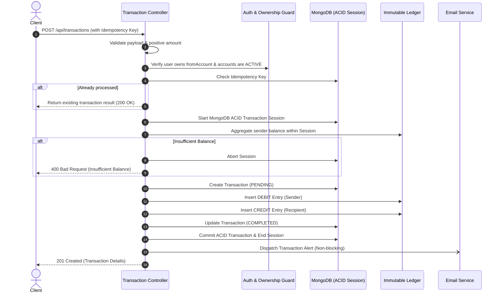

# 🏦 Backend Ledger — Double-Entry Financial Ledger API

[](https://nodejs.org/)
[](https://expressjs.com/)
[](https://www.mongodb.com/)
[](https://mongoosejs.com/)
[](https://jwt.io/)

A production-grade, double-entry banking and transaction ledger service built with Node.js, Express 5, and MongoDB. 

Instead of naively mutating an account balance field, this service adheres to the financial gold standard of **double-entry bookkeeping** with an **append-only immutable ledger**, **multi-document ACID transactions**, and **idempotency keys** to prevent double-spending.

---

## 🌟 Core Engineering Features

- **Double-Entry Bookkeeping**: Balances are calculated dynamically by aggregating immutable `DEBIT` and `CREDIT` entries.
- **Append-Only Immutability**: Protected at the database schema level via Mongoose pre-hooks (`findOneAndUpdate`, `updateOne`, `deleteOne`, `deleteMany`, etc.) to prevent alteration or deletion of audit records.
- **ACID Transactions**: Atomic consistency across transfers and ledger entries using MongoDB multi-document transaction sessions (`session.startTransaction()`).
- **Idempotency Protection**: Unique `idempotencyKey` per transaction prevents duplicate transfers on network retries or double clicks.
- **Strict Authorization (Anti-BOLA/IDOR)**: Ensures users can only transfer funds from accounts they strictly own.
- **Concurrency & Race-Condition Safe**: Re-evaluates account balances within the active ACID transaction session.
- **JWT Revocation & Blacklisting**: Logout support using a MongoDB token blacklist with a 3-day TTL index for automatic memory purging.
- **Non-Blocking Notifications**: Transactional emails dispatched asynchronously without blocking the API response cycle.
- **Centralized Error Handling**: Standardized error responses for Mongoose `ValidationError`, `CastError`, and MongoDB duplicate key conflicts (`code: 11000`).

---

## 🔄 10-Step Transfer Workflow



---

## 🏗️ Architecture: Mutable Balance vs. Append-Only Ledger

| Feature | Naive Banking API | Backend Ledger (This Project) |
| :--- | :--- | :--- |
| **Balance Model** | Mutable integer/float column (`balance += amount`) | **Derived dynamically** from `DEBIT` / `CREDIT` journal entries |
| **Audit Trail** | None. Overwritten on every transfer | **100% Immutable**. Previous records can never be edited or deleted |
| **Concurrency** | Vulnerable to race conditions | **ACID Sessions** with transactional balance reads |
| **Network Retries** | Can trigger double charges | **Idempotent** via unique `idempotencyKey` tracking |
| **Tamper Protection** | None | **Schema-level hooks** reject all update/delete operations |

---

## 🚀 Quick Start

### 1. Prerequisites
- [Node.js](https://nodejs.org/) (v18 or higher)
- [MongoDB](https://www.mongodb.com/) (Replica Set enabled for MongoDB multi-document transactions)

### 2. Installation
```bash
# Clone the repository
git clone https://github.com/ChaitanyaTi/double-entry-ledger-api.git

# Navigate to project directory
cd double-entry-ledger-api

# Install dependencies
npm install
```

### 3. Environment Setup
Copy the environment template and configure your secrets:
```bash
cp .env.example .env
```

Edit `.env`:
```env
PORT=3000
MONGO_URI=mongodb://localhost:27017/backend-ledger
JWT_SECRET=your_jwt_secret_key_here

# Gmail OAuth2 (Optional - emails will log to console if not set)
EMAIL_USER=your_email@gmail.com
CLIENT_ID=your_oauth_client_id
CLIENT_SECRET=your_oauth_client_secret
REFRESH_TOKEN=your_oauth_refresh_token
```

### 4. Run the Server
```bash
# Development mode (with auto-reload)
npm run dev

# Production mode
npm start
```

---

## 📡 API Reference

### Authentication (`/api/auth`)

| Method | Endpoint | Description | Auth Required |
| :--- | :--- | :--- | :--- |
| `POST` | `/api/auth/register` | Register a new user | ❌ |
| `POST` | `/api/auth/login` | Authenticate and obtain JWT cookie/token | ❌ |
| `POST` | `/api/auth/logout` | Revoke token and blacklist via MongoDB TTL | ✅ |

#### Register Example:
```json
// POST /api/auth/register
{
  "name": "Jane Doe",
  "email": "jane@example.com",
  "password": "Password123"
}
```

---

### Accounts (`/api/accounts`)

| Method | Endpoint | Description | Auth Required |
| :--- | :--- | :--- | :--- |
| `POST` | `/api/accounts` | Create a new bank account (defaults to INR) | ✅ |
| `GET` | `/api/accounts` | Get all accounts belonging to the authenticated user | ✅ |
| `GET` | `/api/accounts/balance/:accountId` | Get derived balance for a specific account | ✅ |
| `GET` | `/api/accounts/statement/:accountId` | Get account statement with all ledger entries | ✅ |

---

### Transactions (`/api/transactions`)

| Method | Endpoint | Description | Auth Required |
| :--- | :--- | :--- | :--- |
| `POST` | `/api/transactions` | Execute an idempotent money transfer | ✅ |
| `POST` | `/api/transactions/system/initial-funds` | Seed initial funds (System user only) | ✅ (System) |

#### Transfer Example:
```json
// POST /api/transactions
// Headers: Authorization: Bearer <TOKEN>
{
  "fromAccount": "664fa1e2b5c01b2a4d5e6789",
  "toAccount": "664fa1e2b5c01b2a4d5e6790",
  "amount": 500,
  "idempotencyKey": "tx-uuid-12345-67890"
}
```

---

## 🛡️ Security Best Practices Implemented

- **Password Hashing**: Passwords are salted and hashed using `bcryptjs` (cost factor 10) and excluded from default queries (`select: false`).
- **Broken Object Level Authorization (BOLA) Prevention**: Strictly validates that `fromAccount.user === req.user._id` before initiating transactions.
- **Safe Session Cleanup**: Transactions enforce `session.abortTransaction()` and `session.endSession()` in `try/catch/finally` blocks to prevent connection leaks.
- **Token Blacklisting**: Immediate JWT revocation on logout backed by a self-pruning MongoDB TTL index (`expireAfterSeconds: 259200`).
- **Sanitized Logging**: No sensitive user credentials or plaintext passwords are leaked to stdout.

---

## 📄 License
ISC
